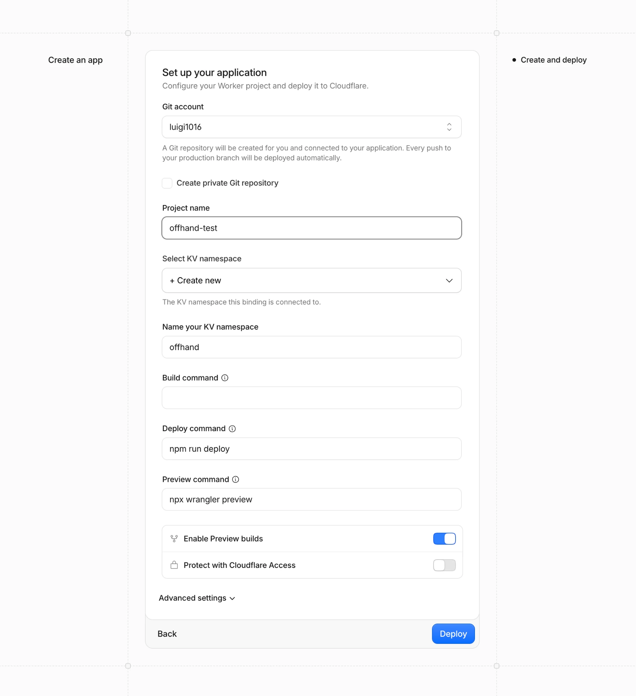
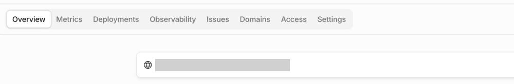
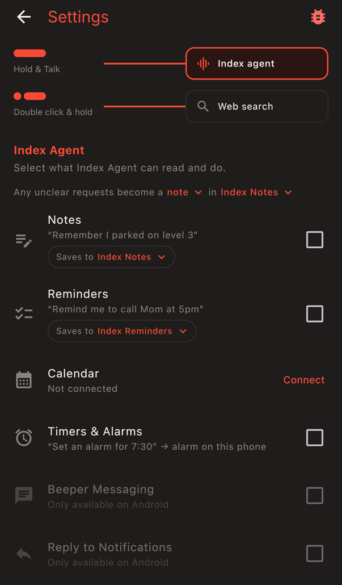
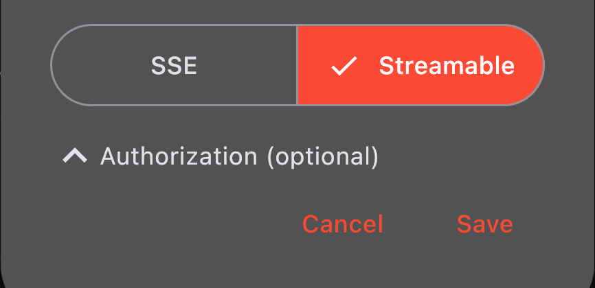
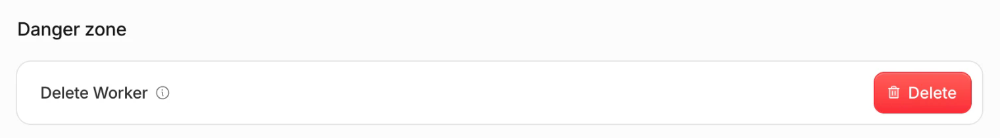
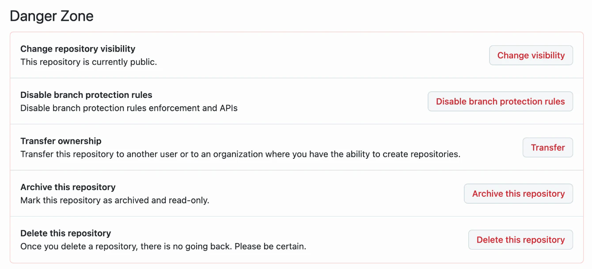

# Install offhand

## Before you start

You need:

- A **Cloudflare** account. Free. [Sign up](https://dash.cloudflare.com/sign-up).
- A **GitHub** account.
- A **Roma** account with at least one list. [roma.app](https://roma.app).
- A **device**. The Pebble Index 01 ring with the Pebble app is the only device offhand has been tested with. Any app that can add an MCP server should work.

## Step 1. Deploy

1. Click the button above. Sign in to Cloudflare if Cloudflare asks.
2. On the form, pick your GitHub account under **Git account**. The first time, Cloudflare asks to connect to GitHub: approve the connection.
3. Leave every other field on the form unchanged.
4. Click **Deploy** at the bottom and wait for the build to finish. The build takes about a minute.

**You should see:** the form above, which asks for no token, key or secret, then a build that ends in success.

Cloudflare has now made three things in your accounts: a copy of this code in a new GitHub repository, a Worker that runs that code, and a small storage space for the Worker, called a KV namespace.

## Step 2. Open your Worker

1. In Cloudflare, open **Workers & Pages** and click your new Worker. The Worker has the project name from the form.
2. On the Worker's **Overview** page, the Worker's address is the link at the top, ending in `.workers.dev`. The picture shows that link as a grey bar.
3. Click the address.

No address there? Open the **Domains** tab and switch on the toggle next to **Production**.

**You should see:** a page that says **offhand is up**, with one button: **Connect Roma**.

## Step 3. Connect Roma

1. Click **Connect Roma**. The button opens roma.app.
2. Sign in to Roma if Roma asks, then approve offhand.

**You should see:** your setup page. The page's title is **offhand**, and under **1. Item store** the page says **Connected**.

Bookmark the setup page now. The bookmark is the only way back to the setup page. The page's address contains your token, so do not share the link or a screenshot of the page.

## Step 4. Set up your device

The setup page has two things to paste, each with a **Copy** button: an **MCP server URL** and an **Authorization header**.

### Pebble Index 01

In the Pebble app, open **Index**, then its **Settings**:

1. Set **Hold & Talk** to **Index agent**.
2. Uncheck **Notes** and **Reminders**. Left on, Pebble keeps what you say in its own lists and offhand never hears it.

3. Add an MCP server. Paste the **MCP server URL** from the setup page into **URL**.
4. Choose **Streamable**, not SSE.
5. Tap **Authorization (optional)** to open it and paste the whole **Authorization header** from the setup page, the word `Bearer` included. The header is required: without the header, Pebble says "unauthorized".
6. Tap **Save**.

### Any other device

Add an MCP server of the kind **Streamable HTTP**, with the URL and the header from the setup page.

## Step 5. Add your first item by voice

The bottom of the setup page shows the lists offhand can see. Use one of yours in place of "groceries".

| Say | You should see |
|---|---|
| "add milk to groceries" | milk on that list in Roma |
| "what's on groceries" | the device reads the list back |
| "remind me to call mom at 9am tomorrow" | an item in Roma due tomorrow at 9:00 in the morning, your time |

That is the whole install.

## Update your Worker

Your Worker keeps running the offhand code from the day you deployed. To get the latest offhand code, delete the Worker and your copy of the code, then deploy again. Do not delete the KV namespace: the namespace holds your token and your Roma sign-in, so your device keeps working with no new setup.

1. **Delete the Worker.** Cloudflare, Workers & Pages, your Worker, Settings, scroll to the bottom, Delete.

   

2. **Delete your copy of the code.** On GitHub, open the repository Cloudflare made in Step 1 (the repository has your project name), then Settings, Danger Zone, Delete this repository.

   

3. **Deploy again.** Do [Step 1](#step-1-deploy) again and type the same project name as before. Under **Select KV namespace**, pick the namespace from your first install, not "Create new".

Your bookmarked setup page still opens and still says **Connected**.

## Remove offhand

Delete these three things, in this order:

1. **The Worker.** Cloudflare, Workers & Pages, your Worker, Settings, scroll to the bottom, Delete.
2. **The KV namespace.** Cloudflare, Storage & Databases, KV, the Worker's namespace, Delete.
3. **Your copy of the code.** On GitHub, open the repository Cloudflare made in Step 1, then Settings, Danger Zone, Delete this repository.

Then delete the offhand MCP server in your device's app.
